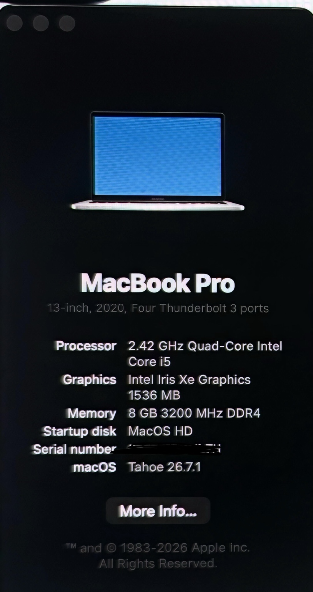
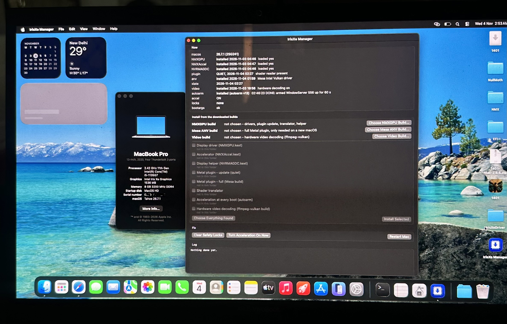

<div align="center">

# ASUS VivoBook K15 OLED · Hackintosh

### macOS Tahoe 26.7.1 running natively on Intel Tiger Lake-U

<p>
  
  
  
  
</p>

**A documented native macOS installation on the ASUS VivoBook K15 OLED (K513EA), with Intel Iris Xe graphics acceleration working and a Windows/macOS dual-boot setup.**

</div>

---

## ✨ Highlights

- macOS **Tahoe 26.7.1** installed on internal SSD
- **Intel Core i5-1135G7** (Tiger Lake-U, 4 cores / 8 threads)
- **Intel Iris Xe Graphics** with graphics acceleration enabled
- **8 GB DDR4-3200 RAM**
- **Dual boot:** Windows preserved; macOS installed on a separate ~100 GB SSD partition
- Smooth desktop rendering after Iris Xe acceleration setup
- **No WhateverXe components** are included or documented in this repository

> This repository documents my own working result and configuration journey. It is not a universal, ready-to-use EFI for every K513EA unit.

## 🖥️ Hardware & system

| Component | Details |
|---|---|
| Laptop | ASUS VivoBook K15 OLED — K513EA |
| CPU | Intel Core i5-1135G7 (Tiger Lake-U) |
| iGPU | Intel Iris Xe Graphics |
| RAM | 8 GB DDR4 @ 3200 MHz |
| Storage | 256 GB SSD + 1 TB HDD |
| macOS | Tahoe 26.7.1 (Build 25G241) |
| SMBIOS shown in macOS | MacBook Pro (13-inch, 2020, Four Thunderbolt 3 ports) |
| Boot arrangement | Windows + macOS dual boot |
| macOS partition | ~100 GB on SSD |

## 📸 Proof of successful installation

### About This Mac
The system reports macOS Tahoe 26.7.1, Intel Core i5, Iris Xe graphics and 8 GB RAM.



### Iris Xe acceleration status
IrisXe Manager shows the NMX components installed and loaded, acceleration **ON**, locks **none**, and boot arguments status **OK**. The desktop is running smoothly.



## 🧩 Installation approach

1. Prepared the macOS boot setup using **NullMoth 1401**.
2. Installed macOS Tahoe on a dedicated ~100 GB partition on the internal SSD, keeping the existing Windows installation for dual boot.
3. Followed the **zep245 IrisXe-macos-driver** project for Intel Iris Xe graphics acceleration.
4. Installed and verified the required graphics components using IrisXe Manager.
5. Restarted and checked that acceleration was active and the macOS desktop was smooth.

⚠️ **Hardware-specific:** BIOS settings, ACPI, Wi-Fi, audio, trackpad, sleep, external display and other devices can vary between laptop revisions. Do not blindly use this setup on another machine.

## 🙏 Credits & upstream projects

Huge thanks to the developers whose work made this possible:

- **NullMoth — 1401**: boot / EFI creation workflow and project  
  https://github.com/NullMoth
- **zep245 — IrisXe-macos-driver**: Intel Iris Xe graphics driver / acceleration work  
  https://github.com/zep245/IrisXe-macos-driver  
  Release used as a reference: [v1.1.4](https://github.com/zep245/IrisXe-macos-driver/releases/tag/v1.1.4)

Please visit the upstream repositories, read their documentation, and follow their licenses. This repository is a personal success report and credits the original authors; it does not claim ownership of their code.

## 📂 Repository contents

```text
.
├── README.md
├── LICENSE
└── assets
    ├── macos-about-this-mac.jpg
    └── irisxe-acceleration-proof.jpg
```

## ⚖️ Disclaimer

Hackintosh projects involve unsupported configurations and may break after system updates. Back up important data before changing partitions, bootloaders, EFI files, kexts or system extensions. Apple does not support macOS on this ASUS hardware. Use software and components in accordance with their respective licenses.

---

<div align="center">

**Built, tested & documented by [Kaushal-snap](https://github.com/Kaushal-snap)**

⭐ If this documentation helps, star the upstream projects and share your own hardware results.

</div>
